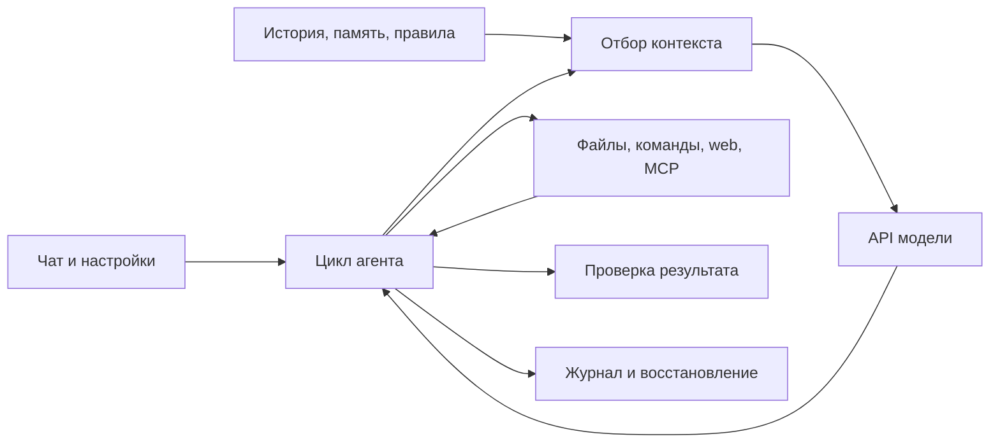

# Workbench

Настольное приложение для macOS и Linux с собственным агентным движком. Electron и React объединяют проекты, отдельные чаты, инструменты работы с файлами и командами, подключение моделей и MCP-серверов.

## Возможности

- Несколько проектов и чатов, закрепление и архивирование задач.
- Собственный цикл агента: чтение и поиск файлов, правки, команды, проверка результата и продолжение прерванных запусков.
- Подключение моделей через OpenAI Responses, OpenAI-compatible Chat Completions и Anthropic Messages, включая OpenRouter.
- Бюджеты запусков, учёт токенов и стоимости, потоковые ответы и отмена выполнения.
- Контекст проекта, правила `AGENTS.md`, skills, вложения, заметки задачи и суммаризация истории.
- MCP-инструменты, просмотр изменений, редактор файлов и откат правок.
- Права на папки и изоляция команд через `sandbox-exec` на macOS и Bubblewrap на Linux.

## Как устроен агент



- **Инструменты:** чтение, поиск и правка файлов, команды и фоновые процессы, web, изображения, история, критерии задачи и подключаемые MCP. Модель видит разрешённые схемы; доступ и исполнение проверяет приложение.
- **Память:** полная история чата, общая память проекта, заметки текущей задачи с источниками, состояние контекста и модельная сводка. Сжатие запроса сохраняет исходную историю для последующего чтения.
- **Выполнение:** потоковые ответы, бюджеты, контроль повторов, проверка результата и квитанции операций для продолжения после сбоя.
- **Границы:** это локальное приложение. Векторной базы, автоматической памяти обо всех чатах и синхронизации между устройствами пока нет.

Подробнее: [карта архитектуры](docs/architecture.md) · [каталог инструментов](docs/architecture/tools.md) · [память и контекст](docs/architecture/memory.md) · [цикл и восстановление](docs/architecture/execution.md).

## Запуск

Требуются **macOS либо Ubuntu 24.04+/Debian 12+** и **Node.js 22.12 или новее**. Зависимости Linux и порядок установки: [инструкция](docs/linux.md).

```sh
git clone https://github.com/dsitd/workbench.git
cd workbench
npm ci
npm run dev
```

Команда запускает Vite на `127.0.0.1:5173` и окно Electron. После изменения основного процесса или backend перезапустите приложение; интерфейс обновляется через Vite.

В настройках добавьте профиль модели и API-ключ, затем выберите папку проекта и создайте чат. Локальный профиль «Демонстрация» работает без обращения к платной модели.

## Проверки и сборка

| Команда | Назначение |
| --- | --- |
| `npm run check` | TypeScript, локальные автоматические тесты и сборка. |
| `npm run smoke` | Проверка Electron через локальный тестовый API. |
| `npm run sandbox:check` | Проверка реальной изоляции команд на macOS/Linux. |
| `npm run bench:check` | Бесплатная сквозная проверка агентного цикла и команд. |
| `npm run build` | Сборка в `dist/`. |
| `npm start` | Запуск собранного приложения. |
| `npm run package` | Распакованное приложение для текущей ОС в `release/`. |
| `npm run dist` | macOS: DMG/ZIP, Linux: AppImage/DEB; автоматическая публикация отключена. |

`check` и `smoke` используют локальные ответы и не вызывают платные модели. Сквозные проверки Electron и sandbox запускайте из обычного терминала macOS/Linux. Пакеты локальные и неподписанные; настройки подписи и notarization в проект не входят.

## Структура

- `src/main` — Electron, IPC и локальное хранилище.
- `src/backend` — доступ к файлам, команды, MCP и сервисы проекта.
- `src/agent` — цикл, контекст, протоколы моделей и контроль завершения.
- `src/renderer` — интерфейс React.
- `src/shared` — общие контракты и схемы.
- `tests` — локальные проверки; `scripts` — сборка и инструменты разработки.

## Документация

- [Архитектура: схема, слои, сущности и границы](docs/architecture.md)
- [Инструменты: каталог, discovery, права и расширение](docs/architecture/tools.md)
- [Память и контекст: источники, сжатие и хранение](docs/architecture/memory.md)
- [Выполнение: цикл, бюджеты, завершение и восстановление](docs/architecture/execution.md)
- [Linux: установка, изоляция, сборка и бенчмарки](docs/linux.md)
- [Переносимые бенчмарки](scripts/harness-pilot/README.md)
- [Подключение MCP](docs/mcp.md)
- [Уведомления о сторонних компонентах](THIRD_PARTY_NOTICES.md)

API-ключи вводятся в настройках приложения и сохраняются отдельно в зашифрованном виде. Пользовательские настройки, история и вложения находятся в локальном каталоге данных Workbench. Они не входят в исходники. Ограничения файлового доступа и sandbox подробно описаны в документации архитектуры.
