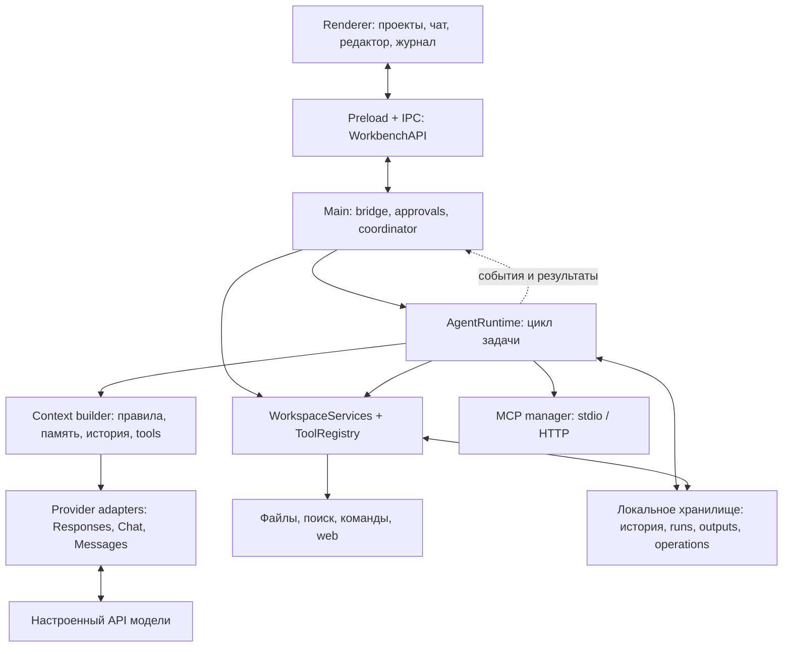

# Архитектура Workbench

Workbench — настольное приложение Electron для macOS и Linux со своим агентным runtime. Модель выбирает следующие действия, а приложение формирует доступный контекст, проверяет инструменты, выполняет их, сохраняет состояние и решает, можно ли завершить запуск. История, память, разрешения и журнал операций принадлежат приложению.

Документ описывает реализацию в этом репозитории. Основные подробности вынесены в отдельные разделы:

- [Инструменты: полный каталог, discovery, права и расширение](architecture/tools.md)
- [Память и контекст: хранение, отбор, сжатие и восстановление](architecture/memory.md)
- [Выполнение: цикл, провайдеры, бюджеты, завершение и ошибки](architecture/execution.md)
- [Настройка MCP-подключений](mcp.md)

## 1. Общая схема

Renderer не выполняет shell-команды и не обращается к ключам модели напрямую. Main связывает UI, runtime и backend через внедряемые зависимости. Это позволяет проверять агентный цикл на локальных ответах API без запуска Electron.

## 2. Слои и точки входа

| Слой | Основные файлы | Ответственность |
| --- | --- | --- |
| Интерфейс | [App.tsx](../src/renderer/App.tsx), [Chat.tsx](../src/renderer/components/Chat.tsx), [ContextView.tsx](../src/renderer/components/ContextView.tsx) | Чаты, модели, редактор, ход работы, расходы и состав контекста. |
| Граница процессов | [preload.ts](../src/main/preload.ts), [bridge.ts](../src/main/bridge.ts), [types.ts](../src/shared/types.ts) | Типизированный `WorkbenchAPI`, IPC-команды и события `AgentEvent`. |
| Координация | [run-coordinator.ts](../src/main/run-coordinator.ts), [approvals.ts](../src/main/approvals.ts) | Проверки проекта, название чата, остановка и ожидание разрешений. |
| Агент | [index.ts](../src/agent/index.ts), [runtime.ts](../src/agent/runtime.ts), [limits.ts](../src/agent/limits.ts) | Один активный запуск на чат; цикл по фазам: подготовка шага, запрос модели, исполнение вызовов, гейты завершения. Границы харнесса собраны в одном модуле. |
| Контекст | [context.ts](../src/agent/context.ts), [context-selection.ts](../src/agent/context-selection.ts) | Отбор правил, skills, истории, памяти, файлов и схем в пределах окна модели. |
| Провайдеры | [providers.ts](../src/agent/providers.ts), [mappings.ts](../src/agent/mappings.ts), [http.ts](../src/agent/http.ts) | Протоколы моделей, streaming, аргументы tool calls, отмена, usage и ограниченные повторы. |
| Сервисы проекта | [backend/index.ts](../src/backend/index.ts), [tool-registry.ts](../src/backend/tool-registry.ts) | Файлы, поиск, процессы, web, skills, история, снимки и обработчики инструментов. |
| Внешние инструменты | [mcp/index.ts](../src/backend/mcp/index.ts), [main/mcp.ts](../src/main/mcp.ts) | Каталоги MCP, соединения, разрешения, авторизация и вызовы. |
| Состояние | [storage.ts](../src/backend/storage.ts), [message-log.ts](../src/backend/message-log.ts), [runs.ts](../src/backend/runs.ts), [operations.ts](../src/backend/operations.ts) | Метаданные проектов и чатов, append-only история каждого чата, тела снимков файлов, журнал запусков и исходов действий. |

`AgentDependencies` в [shared/agent.ts](../src/shared/agent.ts) — контракт runtime с окружением. Через него приходят история, настройки, credentials, инструментальный host, проверки, доступ к вложениям и сохранение результатов. `ToolDefinition` описывает схему и класс разрешений; `ToolCall` — конкретный вызов; `ToolResult` — наблюдаемый результат.

## 3. Основные сущности

| Сущность | Что хранит и где используется |
| --- | --- |
| `Project` | Разрешённые папки, интернет, command policy, инструкции, память проекта, закрепления, команда проверки. |
| `Session` | Чат проекта: выбранная модель и режим, название, архив, пользовательские лимиты. |
| `ChatMessage` | Сообщение пользователя/модели/инструмента, ID, tool calls/results, ссылки на вложения и область доступа. |
| `RunRecord` | Один запуск задачи: статус, шаги, расходы, план, критерии, notes, состояние контекста и ID операций. Продолжение создаёт новый run с `parentRunId`. |
| `OperationRecord` | Квитанция конкретного действия: идентификатор, отпечаток аргументов, область доступа, исход и сохранённый результат. |
| `ContextReport` | Объяснение того, что включено в запрос и сколько примерно токенов занимает. Это диагностика, а не полная история. |
| `TaskCheckpoint` | Группа снимков файлов для отмены изменений задачи. Не равен checkpoint контекста. |

Контракты: [shared/runs.ts](../src/shared/runs.ts), [shared/task-evidence.ts](../src/shared/task-evidence.ts), [shared/context.ts](../src/shared/context.ts), [shared/workspace.ts](../src/shared/workspace.ts).

## 4. Путь одной задачи

1. UI отправляет текст и ID вложений через IPC. Bridge проверяет состояние чата и запускает runtime.
2. Runtime получает проект, модель и настройки, создаёт `RunRecord`, сохраняет исходный запрос и явные критерии приёмки.
3. Перед каждым шагом формируется разрешённый каталог инструментов и контекст. Большая история отбирается и при необходимости сжимается; исходники сохраняются локально.
4. Адаптер отправляет запрос модели. Текст показывается потоково, tool calls сначала разбираются и валидируются.
5. Runtime исполняет инструменты через backend/MCP, сохраняет результаты с теми же call ID, учитывает расходы и обновляет состояние задачи.
6. При наличии следующих действий цикл повторяется. При попытке завершить задачу проверяются свежесть проверки, критерии и неизвестные исходы операций.
7. Итоговый статус и ответ сохраняются; UI получает обновления. Лимит, отмена, ошибка и успешное завершение различаются.

Подробная последовательность и обработка прерываний — в [разделе выполнения](architecture/execution.md).

## 5. Как связаны инструменты и память

Инструменты дают модели доступ к наблюдаемым данным. Например, `read_file` возвращает содержимое и версию файла, `search_history` находит сообщение с ID, а `get_operation` читает сохранённый исход действия. Модель может записать решение через `record_task_note`, но эта запись остаётся её утверждением с источниками.

В следующий запрос context builder отдельно включает инструкции, выбранные схемы, доступную историю и изменяемое состояние задачи. Заметка или сводка не расширяет разрешения и не подтверждает выполнение критерия. Для подтверждения нужен подходящий успешный результат инструмента, актуальный для текущей ревизии и области доступа.

[Каталог инструментов](architecture/tools.md) показывает, какие вызовы доступны сразу, какие загружаются по запросу, а какие создаёт сам runtime. [Раздел памяти](architecture/memory.md) описывает границы хранения между проектом, чатом и запуском.

## 6. Границы исполнения

| Режим | Чтения и web | Правки файлов | Команды | MCP |
| --- | --- | --- | --- | --- |
| `plan` | Разрешённые чтения; web при включённом интернете | Запрещены | Запрещены | Запрещён |
| `auto-edit` | В пределах проекта | В доступных для записи папках | По command policy проекта | С подтверждением |
| `ask` | Нативные действия требуют подтверждения | С подтверждением | С подтверждением | С подтверждением |
| `bypass` | Без запросов подтверждения | Без запросов подтверждения | Без запросов подтверждения | Без запросов подтверждения |

Во всех режимах сохраняются проверки папок, вложенных прав, защищённых путей, интернет-настроек и sandbox. Bypass не предоставляет произвольного доступа к компьютеру. Удалённый MCP работает в окружении своего сервера; локальная sandbox не ограничивает его аккаунт.

Реализация: [modes.ts](../src/shared/modes.ts), [access.ts](../src/backend/access.ts), [commands.ts](../src/backend/commands.ts), [tool-registry.ts](../src/backend/tool-registry.ts). Установленные skills не меняют эти границы.

## 7. Развитие и проверка

- Новый нативный инструмент добавляется как `RegisteredTool` со схемой и обработчиком, затем регистрируется в `WorkspaceServices.toolRegistry`. Сначала определяют его права и побочные эффекты. [Порядок расширения](architecture/tools.md#расширение).
- Runtime hooks получают копии наблюдений; `finishTurn` может запросить продолжение, но не объявить задачу выполненной в обход проверок. [hooks.ts](../src/agent/hooks.ts).
- `npm run check` проверяет типы, локальные тесты и сборку. `npm run smoke` проверяет Electron, `npm run sandbox:check` — реальную изоляцию в обычном терминале macOS/Linux.
- Основные проверки поведения: [runtime-entry](../tests/runtime-entry.test.ts), [harness-execution](../tests/harness-execution.test.ts), [task-memory](../tests/task-memory.test.ts), [model-compaction](../tests/model-compaction.test.ts), [operation-recovery](../tests/operation-recovery.test.ts), [backend-tool-registry](../tests/backend-tool-registry.test.ts).

## 8. Ограничения реализации

Контекст отбирается эвристически; векторного хранилища, embeddings и глобального семантического поиска по всем чатам нет. Модельная сводка может потерять детали, поэтому существуют исходная история и инструменты её чтения. Записи notes относятся к задаче, а не к автоматически обучаемой памяти пользователя.

Проверка проекта доказывает только то, что проверяет её команда. Критерии сопоставляются с наблюдениями по явно заданным условиям; runtime не доказывает полноту произвольного пользовательского запроса. Квитанции операций уменьшают риск повтора, но не создают распределённую транзакцию с внешним сервисом.

Рабочее состояние хранится в локальных JSON-файлах; это приложение одного пользователя, без серверной очереди задач, коллективной базы знаний и синхронизации между устройствами. Сборки macOS/Linux локальные и неподписанные.

## 9. Платформенный слой

`src/backend/sandbox/` задаёт общий `prepareSandbox` для команд, Git и локальных MCP-серверов: Seatbelt/macOS и Bubblewrap/Linux. На Linux используются bash, вложенные bind/ro-bind права, скрытый каталог приложения и маски существующих защищённых путей. При отсутствии работоспособной изоляции запуск запрещён. Ключи сохраняются только с системным хранилищем, без `basic_text`. Ограничения маскирования и требования к Ubuntu/Debian описаны в [linux.md](linux.md).

Основной benchmark runner и memory replay запускаются под Node. Интерпретаторы доступны исполнителю отдельно от индексируемых папок проекта. `npm run bench:check` проверяет локальные ответы модели, чтение, правку, команду и автоматическую проверку без платных запросов. CI запускает проверки на macOS и Ubuntu.
