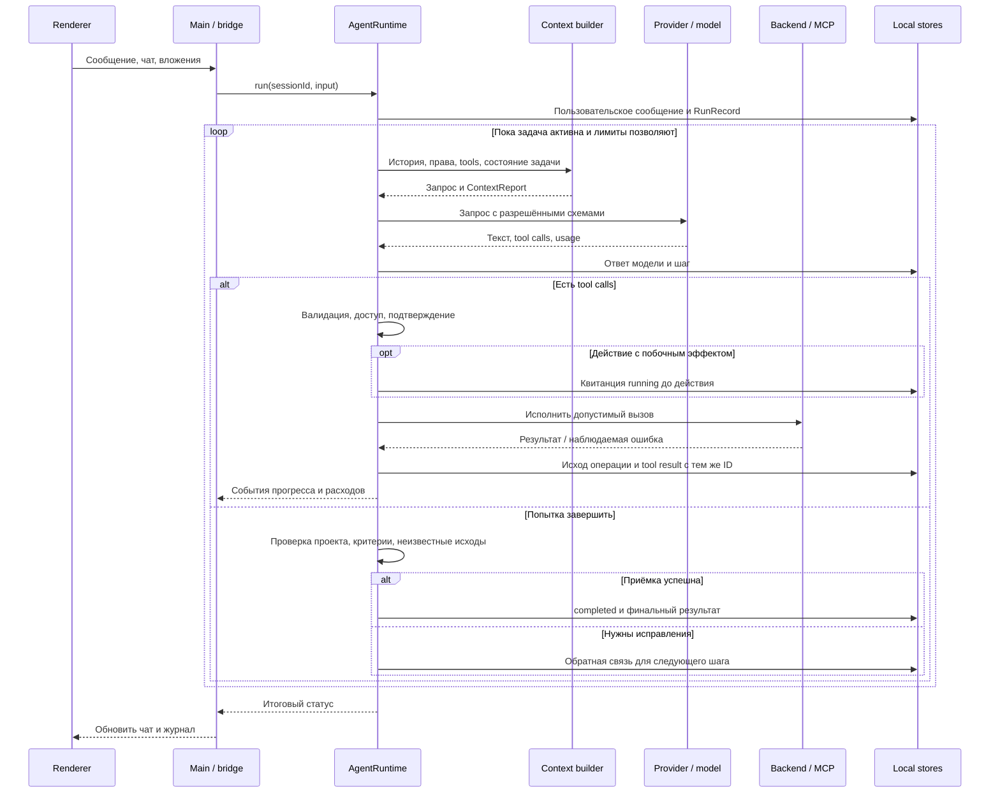

# Цикл выполнения и восстановление

[Общая архитектура](../architecture.md) · [Инструменты](tools.md) · [Память и контекст](memory.md)

Модель предлагает следующий шаг и текст ответа. `AgentRuntime` управляет жизненным циклом: собирает контекст, вызывает провайдера, проверяет и исполняет инструменты, сохраняет наблюдения, применяет лимиты и принимает либо отклоняет завершение. Один чат имеет не более одного активного запуска.

## Последовательность

Точка входа — [agent/index.ts](../../src/agent/index.ts), реализация — [runtime.ts](../../src/agent/runtime.ts). [bridge.ts](../../src/main/bridge.ts) собирает зависимости: сервисы проекта, журнал, хранилище credentials, подтверждения, MCP и координатор проверок. Runtime не зависит от компонентов React.

Цикл разбит на фазы с общим состоянием запуска: открытие и проверка чата, модели и продолжаемого run; восстановление продолжения или сохранение новой задачи; подготовка шага (права, каталог инструментов, контекст, резерв бюджета); запрос модели; исполнение объявленных вызовов; гейты завершения. Проверки проекта и критериев, которые добавляет сам runtime, объявляются и получают парный результат так же, как вызовы модели. Сбой, остановка или исчерпание бюджета закрываются одним путём: сохраняется учтённый расход, незакрытые вызовы получают результаты «не подтверждено», журнал фиксирует причину. Запуск несовместимого движка отклоняется до цикла, без записи в историю и без запросов к модели. Числовые границы харнесса — резерв окна, размер вывода инструментов, число вызовов за шаг, параллельные чтения, повторы, попытки завершения, лимиты `explore_code` — собраны в [limits.ts](../../src/agent/limits.ts).

## Перед выполнением инструментов

1. Проверить актуальные проект, модель и режим чата. Конфигурация сверяется повторно в ходе запуска.
2. Разобрать tool calls и JSON-аргументы. Повреждённые аргументы возвращаются модели как ошибка; неполный ответ провайдера не разрешает выполнять внешне корректный фрагмент пакета.
3. Проверить доступность имени в текущем каталоге, JSON Schema, права, интернет и разрешение пользователя, если оно требуется режимом.
4. Для действий с внешними ссылками на сущности применить проверку известных идентификаторов и, когда требуется, модельную проверку действия.
5. Перед побочным эффектом создать квитанцию операции; после действия сохранить результат и наблюдение.
6. Сохранить один tool result на каждый объявленный call ID, в том числе при ошибке или остановке. Только после этого переходить к следующему модельному шагу.

Параллельный запуск ограничен соседними независимыми нативными чтениями; действия и другие инструменты образуют барьер. Порядок результатов соответствует порядку объявлений. Повторяющиеся непродуктивные вызовы ограничивает `RepetitionGuard`. Это защита от зацикливания, а не доказательство смыслового прогресса.

[providers.ts](../../src/agent/providers.ts), [tool-scheduler.ts](../../src/agent/tool-scheduler.ts), [repetition.ts](../../src/agent/repetition.ts), [backend/tool-registry.ts](../../src/backend/tool-registry.ts).

### Проверка действий с внешними сущностями

`action-grounding` сопоставляет используемые идентификаторы, адреса и числовые ссылки с доступным запросом и успешными наблюдениями. Она не понимает произвольный смысл всех текстовых полей. При необходимости `action-review` отправляет отдельный запрос той же модели: предложенное действие, доступные факты и ограничения пользователя. У проверяющего запроса нет инструментов, и он сам не выполняет действие.

Неразрешающий, ошибочный или некорректный ответ блокирует проверяемый вызов. Такой запрос учитывается в общем бюджете. Это дополнительный контроль, который не заменяет проверку прав и схем. Реализация: [action-grounding.ts](../../src/agent/action-grounding.ts), [action-review.ts](../../src/agent/action-review.ts), [action-diff.ts](../../src/agent/action-diff.ts).

## Провайдеры и стоимость

Адаптеры поддерживают OpenAI Responses, OpenAI-compatible Chat Completions и Anthropic Messages. Общий результат содержит текст, tool calls, признак завершённости, usage и данные, необходимые для продолжения соответствующего протокола. Demo-профиль позволяет проверить основной сценарий без платного API.

Запуск ограничивается числом шагов, суммой токенов, временем и стоимостью. Перед запросом проверяется возможность следующего шага с учётом входа и зарезервированного максимального ответа. Внутренние запросы `explore`, `compaction` и `action-review` относятся к тому же бюджету и журналу, а не к бесплатной скрытой работе.

API-стоимость, оценка по настроенным тарифам и неизвестная стоимость различаются. Неизвестная стоимость не приравнивается к нулю. Cache usage берётся из ответа провайдера, когда тот его сообщает. Оценка токенов context builder не подменяет фактический биллинг.

HTTP-слой имеет ограниченные повторы для определённых временных ответов, учитывает отмену и задержки. Повтор запроса модели не означает автоматического повтора инструмента с побочным эффектом. Реализация: [providers.ts](../../src/agent/providers.ts), [mappings.ts](../../src/agent/mappings.ts), [http.ts](../../src/agent/http.ts), [journal.ts](../../src/agent/journal.ts).

## Квитанции операций

Для записей, команд и MCP-действий Workbench хранит `OperationRecord`. ID привязан к проекту, чату, сообщению ассистента и tool call. Отдельный fingerprint включает область доступа, имя и канонические аргументы.

| Статус | Значение |
| --- | --- |
| `running` | Намерение записано, окончательный исход ещё не сохранён. |
| `confirmed` | Сохранён успешный результат инструмента либо исход сверён по наблюдению. |
| `failed` | Сохранён наблюдаемый отказ команды с exit code больше нуля. Это не обещает отсутствия частичных эффектов. |
| `uncertain` | По имеющимся данным нельзя установить исход; например, действие прервалось или вернуло неоднозначную ошибку. |
| `not-executed` | После наблюдения пользователь разрешил считать действие невыполненным и допустить последующий повтор. |

Повтор того же call ID с сохранённым исходом возвращает квитанцию. Идентичное действие с `running/uncertain` блокируется даже при новом call ID. При старте приложения незавершённые `running` переводятся в `uncertain`.

Чтобы снять неопределённость, модель читает квитанцию, наблюдает текущее состояние подходящим инструментом и вызывает `reconcile_operation` с ID успешного свежего наблюдения. Для `not-executed` требуется разрешение пользователя на возможный последующий повтор, в том числе в Bypass. Сама сверка не повторяет действие.

Это защита от слепого повтора, а не гарантия exactly-once во внешней системе. Runtime проверяет источник и свежесть наблюдения, но не может автоматически доказать истинность любого вывода о внешнем эффекте. Реализация и проверки: [operations.ts](../../src/backend/operations.ts), [operation-recovery.test.ts](../../tests/operation-recovery.test.ts).

## Когда задача считается завершённой

Фраза модели «готово» запускает контроль приёмки. В нём участвуют три независимых вида состояния:

- **Критерии.** Явные критерии пользователя могут быть извлечены из структурированного запроса. `set_task_criteria` добавляет условия с точной цитатой исходного запроса и привязкой к наблюдению `toolName/expectedText`. Ранее принятые условия нельзя удалить или ослабить.
- **Проверка проекта.** Если настроена автоматическая проверка, координатор запускает команду или использует подходящий свежий результат. Обычный вызов похожей команды не равен квитанции `verify_project`.
- **Исходы операций.** Незавершённые и неопределённые действия требуют разрешения своего состояния; успешный тест не закрывает их автоматически.

Наблюдения привязаны к области доступа и `mutationRevision`. Возможное изменение файлов или внешнего состояния увеличивает ревизию; результаты прежней ревизии нельзя автоматически использовать как доказательство текущего состояния. `record_task_evidence` привязывает существующий успешный tool result, а не свободное утверждение модели. Подходящие наблюдения также могут сопоставляться автоматически.

При доступном `finish_task` модель вызывает его отдельно с итоговым текстом. Runtime выполняет проверки до публикации завершения. Неуспех возвращает управление модели. Обычный финальный текст без tools тоже проходит контроль; `check_completion` сообщает незакрытые условия, чтобы агент мог исправить результат. Число таких повторных попыток ограничено.

`completionPolicy: natural` отключает автоматический проектный прогон и предложение `finish_task`, но сохраняет контроль критериев и неопределённых операций. Дополнительная настройка `behaviorVerification` добавляет проверку воспроизведения и регрессии; по умолчанию она выключена.

Предел этой системы — содержание критериев и тестов. Прохождение команды не доказывает полноту произвольной задачи. Без явно заданных условий движок не умеет формально проверить любое пожелание пользователя. Заметки, сводки, планы и чтение старого архива не заменяют свежих наблюдений.

Реализация: [task-contract.ts](../../src/agent/task-contract.ts), [completion-guidance.ts](../../src/agent/completion-guidance.ts), [shared/evidence-policy.ts](../../src/shared/evidence-policy.ts), [run-coordinator.ts](../../src/main/run-coordinator.ts). Проверки: [task-contract-runtime](../../tests/task-contract-runtime.test.ts), [finish-task](../../tests/finish-task.test.ts).

## Прерывание и продолжение

На диске сохраняются история, шаги run и checkpoint с ID исходного сообщения, последнего ответа ассистента и ещё не закрытых tool calls. При восстановлении прежний активный запуск отмечается как прерванный; продолжение создаёт новый `RunRecord` с `parentRunId`.

В него копируются план, notes, критерии, наблюдения, операции, ревизия изменений, сводка и выборка контекста, выбранные инструменты и состояние проверки. Отсутствующие tool results восстанавливаются из надёжно сохранённых квитанций. Если квитанции нет, записывается результат об неизвестном исходе; действие не исполняется повторно только ради заполнения истории.

После восстановления агент получает актуальные настройки и доступ, заново собирает контекст и решает следующий шаг. Старый финальный статус не переписывается задним числом. Продолжение, новая задача в том же чате и откат файлов — разные операции.

| Итоговый статус run | Значение для пользователя |
| --- | --- |
| `completed` | Runtime принял завершение по доступным ему условиям. |
| `stopped` | Выполнение остановлено. |
| `error` | Ошибка исполнения или невозможность пройти обязательный контроль. |
| `limited` | Достигнут лимит запуска. |
| `incomplete` | Ответ или выполнение осталось незавершённым. |
| `interrupted` | Прежний активный run обнаружен после прерывания приложения. |

Статус `running` используется во время работы. Возможность продолжения хранится отдельно: не всякий финальный статус означает, что запуск допустимо автоматически возобновить. Реализация: [recovery.ts](../../src/agent/recovery.ts), [backend/runs.ts](../../src/backend/runs.ts), [shared/runs.ts](../../src/shared/runs.ts).

## Проверки контракта runtime

`npm run check` запускает локальную проверку типов, тестов и сборки. API в тестах заменён локальными ответами. Для этой части архитектуры полезны:

| Тест | Что проверяет |
| --- | --- |
| [harness-execution](../../tests/harness-execution.test.ts) | Последовательность инструментов, ошибки, отмена и парность результатов. |
| [backend-tool-registry](../../tests/backend-tool-registry.test.ts) | Определения, схемы, обработчики и права. |
| [agent-action-guard](../../tests/agent-action-guard.test.ts) | Контроль действий относительно известных данных. |
| [operation-recovery](../../tests/operation-recovery.test.ts) | Квитанции, неизвестные исходы, продолжение и запрет слепого повтора. |
| [task-contract-runtime](../../tests/task-contract-runtime.test.ts) | Критерии, источники наблюдений и свежесть доказательств. |
| [finish-task](../../tests/finish-task.test.ts) | Приёмка финального ответа и проектная проверка. |
| [agent-failure-billing](../../tests/agent-failure-billing.test.ts) | Учёт запросов при ошибках и ограничениях. |

Проверки настоящего Electron и macOS sandbox вынесены в `npm run smoke` и `npm run sandbox:check`, запускаемые из обычного macOS Terminal. Локальные тесты провайдера не подтверждают доступность конкретного платного API или корректность каждого подключённого внешнего MCP-сервера.
