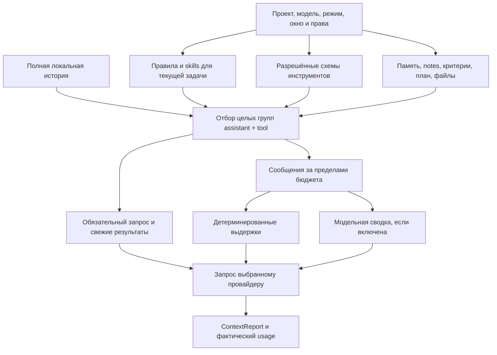

# Память и контекст

[Общая архитектура](../architecture.md) · [Инструменты](tools.md) · [Цикл выполнения](execution.md)

Память Workbench состоит из нескольких механизмов с разной областью действия. История сохраняет исходные сообщения, память проекта — решения пользователя, заметки задачи — ход работы, а context builder выбирает, какую часть этого показать модели на очередном шаге. Сжатие запроса не удаляет историю с диска.

## Виды памяти

| Механизм | Кто записывает | Область и срок жизни | Как используется |
| --- | --- | --- | --- |
| История `ChatMessage[]` | Пользователь и runtime | Чат; сохраняется между перезапусками приложения | Последние целые группы сообщений попадают в запрос; остальное можно получить инструментами истории. |
| Память `Project.memory` | Пользователь через настройки проекта | Проект, общая для его чатов | Включается как справочный контекст; до 12 000 символов в запросе, с пометкой при сокращении. |
| Заметки `RunRecord.taskNotes` | Модель через `record_task_note` | Задача и её явные продолжения | Активные заметки с источниками помогают сохранить решения, ограничения и незакрытые вопросы. |
| `ContextCheckpoint` | Детерминированный код runtime | Запуск и его продолжение | Ограниченные выдержки: исходная задача, последнее уточнение, явные ограничения, файлы, наблюдения и открытая работа. |
| `ModelHistorySummary` | Отдельный запрос той же модели | Чат, с проверкой области доступа и исходников | Смысловая сводка сообщений, не поместившихся в запрос. Может быть использована в следующем запуске этого чата. |
| План и критерии | Модель; явные критерии также извлекает runtime | Запуск и его продолжение | План показывает ход работы, критерии задают проверяемые условия. Отметка плана не подтверждает критерий. |
| Большие результаты инструментов | `ToolOutputStore` | Проект и чат, с привязкой к области доступа | Вывод читается частями по `resultId`, без повторного запуска команды. |
| Квитанции `OperationRecord` | Backend и MCP-обвязка | Проект и чат | Сохраняют исход действия, чтобы продолжение не повторяло неизвестный побочный эффект. |

Обычное новое сообщение создаёт новую задачу: полный набор notes, план и критерии предыдущего run не копируются автоматически. Предыдущие сообщения остаются в истории; валидная модельная сводка может использоваться повторно. Кнопка продолжения прерванного run явно восстанавливает его рабочее состояние. См. [runtime.ts](../../src/agent/runtime.ts).

`AGENTS.md` и skills относятся к инструкциям и процедурам, а не к автоматически накопленным фактам. `Session.summary` — краткая сводка чата; она не заменяет исходную историю и проверяемые результаты.

## Заметки задачи

`record_task_note` загружается через `load_task_tools`. Поддерживаются семь типов:

| Тип | Что сохранять |
| --- | --- |
| `objective` | Цель из сообщения пользователя. |
| `constraint` | Явное ограничение пользователя. |
| `decision` | Принятое решение и основание. |
| `rejected_hypothesis` | Отвергнутая гипотеза и причина отказа. |
| `finding` | Полученное наблюдение или вывод. |
| `open_question` | Вопрос, на который ещё нет ответа. |
| `next_step` | Следующее действие. |

Пример аргументов после успешного чтения источников; идентификаторы в примере условные, реальные возвращают инструменты истории:

```json
{
  "kind": "rejected_hypothesis",
  "text": "Задержка не объясняется повторной загрузкой одного файла.",
  "rationale": "Журнал содержит одно чтение, задержка возникает после него.",
  "sourceMessageIds": ["message_from_history"]
}
```

Для `objective` и `constraint` обязательна точная `sourceQuote` из доступного сообщения пользователя. Для `rejected_hypothesis` обязательна `rationale`. Все записи ссылаются на 1–8 публичных сообщений текущего чата: системные сообщения и недоступная история не принимаются.

Результат возвращает ID заметки. Повторный вызов с этим `id` обновляет запись; `status: resolved` или `superseded` убирает её из активной памяти. Закрытая версия остаётся в истории вызовов. Лимит — 24 активные записи и 16 000 символов их сериализованного содержимого. При заполнении runtime возвращает ошибку и предлагает объединить или закрыть записи; молча удалять активные заметки он не будет.

Модель получает небольшой справочник `task-memory-sources`: ID, роль и выдержки доступных сообщений. Это навигация, а не полный текст источника. Для точного цитирования пропущенного текста нужны `search_history` и `read_history`.

Заметка — утверждение модели со ссылками. Runtime проверяет доступность источников и обязательные поля, но не доказывает истинность произвольного вывода. Заметка не становится новой инструкцией пользователя, разрешением на действие или доказательством выполнения задачи. Реализация и тесты: [task-memory.ts](../../src/agent/task-memory.ts), [task-memory.test.ts](../../tests/task-memory.test.ts).

## Как собирается запрос модели



1. **Рассчитать бюджет.** Жёсткий входной предел — `contextWindow − maxOutputTokens − 1024`. Пользовательский target может уменьшить рабочее окно. Последний запрос нельзя молча обрезать: если обязательный контекст не помещается даже в жёсткий предел, запуск получает явную ошибку.
2. **Загрузить правила.** Учитываются глобальные, проектные и подходящие вложенные инструкции. Пути текущего запроса и недавних инструментов помогают выбрать вложенные правила. Уже встретившиеся правила удерживаются в состоянии текущей задачи, содержимое перечитывается с диска.
3. **Выбрать skills.** Явное упоминание имеет приоритет; неявный выбор использует названия и описания. Ресурсы skill дочитываются через `read_skill_resource`. Skill задаёт процедуру работы, но не расширяет права инструментов.
4. **Подготовить справочные данные.** Память проекта, notes, критерии, план, доступные наблюдения, закреплённые файлы, ссылки `@file` и ограниченная карта проекта. Файловый и символьный поиск используют эвристики, пути и структуру кода, а не векторную базу.
5. **Отобрать историю.** Сохраняются целые группы assistant/tool. Незавершённая группа остаётся на диске, но не отправляется как корректный обмен. Последнее сообщение пользователя и обязательная свежая группа результатов имеют приоритет.
6. **Сжать остальное.** Применяются детерминированные выдержки и, при включённой настройке, модельная сводка. Исходные сообщения по-прежнему доступны через инструменты истории.
7. **Сформировать запрос и отчёт.** Инструкции и стабильные схемы отделены от меняющихся данных. Динамический снимок маркируется `contextData: true` и явно описывается как справочные данные, а не новое указание пользователя.

Реализация: [context.ts](../../src/agent/context.ts), [context-selection.ts](../../src/agent/context-selection.ts), [context-history.ts](../../src/agent/context-history.ts), [project-context.ts](../../src/backend/project-context.ts), [skills.ts](../../src/backend/skills.ts).

## Сжатие, продолжение и кэш

`ContextSelectionState` хранит выбранные ID сообщений, хеш содержимого, поставщика модели, хеш правил и номер эпохи. Пока история помещается и политика не изменилась, runtime старается сохранять прежний префикс и дописывать новые сообщения. При переполнении выбирается меньший набор с запасом для дальнейшей работы. Изменение источника с тем же ID или смена правил заставляет пересмотреть выбор.

Модельная суммаризация выполняется **той же настроенной моделью**, без инструментов и изображений. Она сохраняет цель и её уточнения, ограничения, решения с причинами, файлы, проверки и незавершённую работу. Это дополнительный API-запрос: его токены и стоимость входят в бюджет текущего запуска и видны как шаг `compaction`.

Сохранённая сводка привязана к проекту, чату, области доступа, модели и хешам источников. При несовпадении она не считается действительной памятью. Пустой, незавершённый или некорректный ответ не принимается как новая сводка; остаются подходящая предыдущая сводка и детерминированные выдержки. Идентичная неудачная попытка не повторяется бесконечно. Настройка `modelCompaction: false` отключает модельный запрос, сохраняя отбор истории и детерминированный механизм.

Это уменьшает потерю деталей, но не гарантирует идеальное воспоминание. Если точное число, цитата или аргумент важны для действия, модель должна получить исходник. Удержание префикса помогает provider prompt caching, однако реальное попадание в кэш определяется ответом провайдера. Оценка размера контекста и фактический usage — разные показатели.

Реализация: [model-compaction.ts](../../src/agent/model-compaction.ts), [context-state.ts](../../src/agent/context-state.ts), [summary.ts](../../src/agent/summary.ts), [context-usage.ts](../../src/agent/context-usage.ts). Проверки: [model-compaction](../../tests/model-compaction.test.ts), [context-epochs](../../tests/context-epochs.test.ts), [long-context-memory](../../tests/long-context-memory.test.ts).

## Возврат к первоисточникам

| Что нужно восстановить | Инструменты | Контракт |
| --- | --- | --- |
| Раннее сообщение или точная цитата | `search_history` → `read_history` | Literal-поиск в текущем чате; чтение частями, до 12 000 символов за вызов. |
| Пропущенная часть большого вывода | `search_tool_output` / `read_tool_output` | Чтение по `resultId` в той же области доступа; команда не запускается заново. |
| Исход действия после прерывания | `get_operation`, затем наблюдение текущего состояния | Квитанция показывает сохранённый исход, а не автоматически подтверждает весь пользовательский результат. |
| Изображение | `list_attachments` → `inspect_image` | Метаданные и байты разделены; изображение добавляется после явного просмотра и с учётом vision модели. |

История возвращает публичный текст, а не скрытое рассуждение провайдера. Архивы подчиняются проекту, чату и области доступа. Их чтение помогает восстановить факты, но само по себе не является свежей проверкой состояния файлов или внешнего сервиса.

Если полученный от сервиса результат длиннее 18 000 символов, `ToolOutputStore` сохраняет его отдельно; в историю попадают начало, конец и `resultId`. На сохранение есть верхний предел 8 MiB. Это полный **полученный результат сервиса**, который мог ранее ограничить собственный вывод; архив не отменяет лимиты команды, чтения файла или сети. См. [history.ts](../../src/backend/history.ts), [tool-output.ts](../../src/backend/tool-output.ts), [context-tools.ts](../../src/backend/context-tools.ts).

## Хранение на диске

Все пути ниже относительны приватному каталогу данных приложения; это не папка исходного проекта:

```text
<app-data>/
  workspace.json                 проекты, чаты, сообщения, настройки, изменения
  runs/<runId>.json              шаги, usage, план, notes, критерии и контекст run
  operations/<operationId>.json  квитанции побочных эффектов
  tool-output/<resultId>.json    большие результаты инструментов
  attachments/                  импортированные изображения
  skills/global/                установленные общие skills
  skills/project-<projectId>/    установленные skills проекта
```

`StateStore` последовательно применяет изменения и заменяет JSON через временный файл. Записи `PrivateRecords` дополнительно синхронизируют файл и каталог с диском. Файлы состояния создаются с правами `0600`, приватные каталоги — `0700`. Ключи моделей сохраняются отдельно в зашифрованном виде; они не являются частью памяти, контекста или репозитория.

Реализация: [storage.ts](../../src/backend/storage.ts), [runs.ts](../../src/backend/runs.ts), [private-records.ts](../../src/backend/private-records.ts), [credentials.ts](../../src/main/credentials.ts).

## Три разных checkpoint

| Имя | Назначение |
| --- | --- |
| `RunRecord.contextCheckpoint` | Восстановить смысл задачи в ограниченном контексте модели. |
| `RunRecord.checkpoint` | Найти исходное сообщение, последний ответ и tool calls без результатов при продолжении. |
| `TaskCheckpoint`, связанный через `checkpointId` | Сгруппировать снимки файлов для отмены правок. |

Откат файлов не отменяет отправленное MCP-действие или произвольный эффект shell-команды. Восстановление контекста не повторяет автоматически незавершённые действия. Подробности — в [цикле выполнения](execution.md#прерывание-и-продолжение).

## Что пока не реализовано

Нет embeddings, векторной базы, глобального семантического поиска по чатам и автоматического обучения долговременной памяти пользователя. Память проекта ведётся пользователем; инструмент notes сохраняет состояние конкретной задачи. Нет синхронизации памяти между компьютерами. Эти границы важно учитывать при добавлении будущего memory-сервиса: источник, область доступа, обновление и удаление факта должны оставаться явными.
